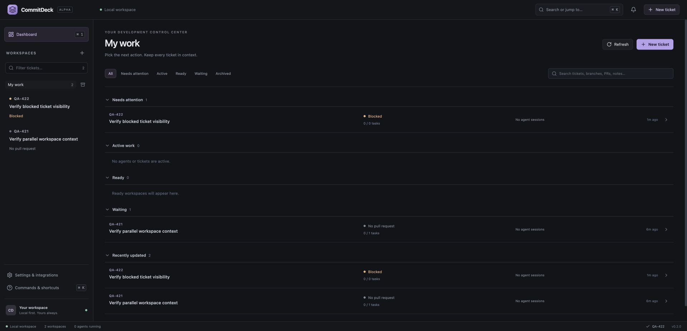
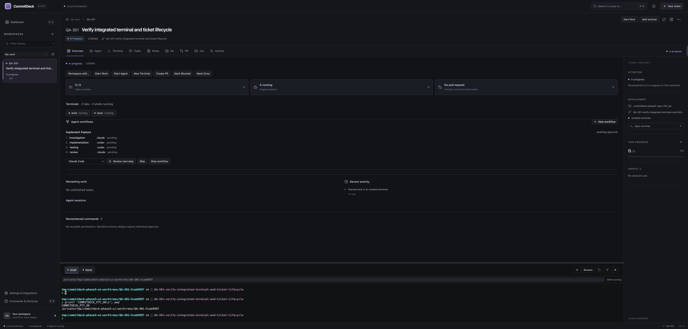

# CommitDeck

**CommitDeck — A workspace for parallel AI-assisted development.**

An open-source desktop workspace that keeps a ticket, isolated Git worktree, notes, TODOs, coding-agent sessions, pull request, reviews, and checks together. Switch tickets without rebuilding your context.

## Functionality

- Manual workspace creation, editing, archive/restore, and confirmed deletion.
- Jira Cloud import by issue key, structured issue details, comments, links, and a local cache; confirmed status transitions, comments, and summary updates.
- Persistent Markdown notes with editor/preview/split views, debounced autosave, serialized writes, and local draft recovery.
- Editable TODOs with completion, progress, drag reorder, and keyboard reorder.
- Local Git repository picker, branch/remote metadata, staged/unstaged/untracked files, and unified diffs.
- Isolated worktrees, existing-branch detection, configurable root, folder/terminal launch, and confirmed cleanup. Dirty worktrees and worktrees containing ignored files are protected. Branches are retained.
- Codex, Claude Code, and OpenCode CLI detection; multiple persistent sessions; concurrent processes across tickets; normalized activity; cancellation; native session resume when a provider returns its session ID.
- GitHub open-PR discovery, reviews, inline review-comment count, CI checks, and sidebar attention states.
- Dark UI, resizable panes, saved layout/selected tabs/sessions/diff files, prompt drafts, and a command palette.
- Dashboard as the launch view: backend priority sorting, Needs attention / Active work / Ready / Waiting / Recently updated sections, persisted collapse choices, archived filter, and search across ticket, branch, PR, and notes.
- Workspace Overview combines attention, agents, remaining tasks, PR/CI, unresolved feedback, permission rules, and a persisted activity timeline.
- In-app approval queue with deny/allow once, exact command rules scoped to a session or workspace, and individual approval for sensitive actions.
- Selectable, purpose-aware workspace context with exact preview, character budget, estimated tokens, truncation markers, secret redaction, SHA-256 snapshots, and explicit refresh.
- Deduplicated in-app notifications for important agent, CI, review, and merge-readiness transitions.
- Independent integration failures: cached Jira/GitHub data remains readable while local work continues. Selected workspaces refresh every 60 seconds, background workspaces every 3 minutes, with two integration jobs at most. Polling pauses while the window is hidden; manual refresh bypasses the interval.

## Phase 3 daily workflow

- Real xterm.js terminals in each ticket worktree, multiple named tabs, PTY resize/interactive input, bounded scrollback, and a resizable dock beside agents or other panes. Shells are explicitly stopped after restart.
- Import native Codex, Claude Code, and OpenCode session metadata, review workspace suggestions, and resume supported native IDs without copying credentials or adopting external processes.
- Agent workspace tools for TODOs, decisions, notes, and blockers with attribution. Add/complete/append can run through a selected session capability; deletion and every note replacement require individual approval. Optional provider skill files are previewed before creation.
- Editable GitHub PR creation/update, draft/ready state, comments, reviewer requests, review replies/resolution, failed GitHub Actions rerun, and guarded squash merge.
- Dynamic Jira transitions, comments, and summary edits. PR/merge follow-ups suggest Jira actions and require a separate confirmation.
- Start Work previews branch/base/fetch/worktree operations. Local lifecycle follows coding, PR, review, merged, Done, and archive while keeping Jira separate.
- Agent workflow presets with provider mapping, exact context preview, compact handoffs, manual approval between steps, and retry/skip/stop recovery.
- Terminal selections, review feedback, and redacted file diffs can be previewed and sent to a chosen agent. Activity has its own tab; sidebar progress, focus states, pane sizes, fuzzy palette commands, and shortcuts are consistent.

Use **Overview → Start Work** after attaching a repository, then **Agent** or **Terminal**. Push the branch in Terminal and open **PR → Create PR** when ready. Review feedback can become a TODO or a focused agent prompt. After merge, update Jira, mark Done, archive, and clean up the worktree when you choose.

See [Terminal](docs/terminal.md), [Session import](docs/session-import.md), [Agent workspace skill](docs/agent-skill.md), and [Lifecycle/workflows/integration writes](docs/workflows.md) for behavior and limits.

| Shortcut               | Action                           |
| ---------------------- | -------------------------------- |
| Cmd/Ctrl+1             | Dashboard                        |
| Cmd/Ctrl+2 / 3 / 4 / 5 | Agent / Terminal / Tasks / Notes |
| Cmd/Ctrl+Shift+A       | New agent session                |
| Cmd/Ctrl+Shift+T       | New terminal                     |
| Cmd/Ctrl+Shift+I       | Import session                   |
| Cmd/Ctrl+Shift+P       | Pending permissions              |
| Cmd/Ctrl+Shift+R       | Refresh workspace                |
| Cmd/Ctrl+K             | Fuzzy command palette            |

Terminal focus preserves shell key bindings. Use the titlebar command button to open application commands while typing in a terminal.

## Screenshots





Screenshots use disposable QA workspaces. The app starts empty and does not seed demo tickets, agents, or integration results.

## Architecture

React + TypeScript + Vite run inside Tauri 2. The small Rust shell launches a bundled Go sidecar and bridges JSON requests and streamed events over private stdin/stdout pipes. Desktop RPC stays on private pipes. Tool-enabled agent turns can access a separate ephemeral, authenticated loopback service scoped to their workspace/session. Go owns SQLite, Git operations, credentials, external integrations, and agent processes.

Browser development uses a same-origin Vite bridge to the same sidecar. It binds to `127.0.0.1:1420`, validates Host/Origin, and rejects non-JSON writes. Desktop development disables that bridge so only one backend opens the database.

See [docs/architecture.md](docs/architecture.md) for domain models, provider interfaces, persistence, event flow, and extension points.

## Prerequisites

- Go 1.27.2 (pinned for patched standard-library builds).
- Node.js 22.12+ and npm. Node 24 LTS is a good development baseline.
- Rust stable and the platform's [Tauri prerequisites](https://v2.tauri.app/start/prerequisites/).
- Git with worktree support, available on `PATH`.
- macOS: Xcode Command Line Tools. Windows: MSVC build tools and WebView2. Linux: WebKitGTK/system packages listed by Tauri and a running Secret Service for credentials.
- Optional integrations: `codex`, `claude`, `opencode`, and `gh`, independently installed and authenticated.

The native application has been built and launched on macOS Apple Silicon. CI builds Windows x64 and Linux x64 installers. Native installation, desktop/keyring behavior and uninstall checks on those systems still require the explicit QA matrix in `docs/release-qa.md`; compilation and headless tests are separate evidence.

## Installation and local development

### Install a release

This branch prepares **v0.1.0-beta.1**. No release is published yet. Build from source below or use PR artifacts for evaluation. After maintainer-approved publication, installers will appear on the [Releases page](https://github.com/glanderson42/commitdeck/releases). The following commands apply only after that beta exists; they do not publish it. Install the GitHub CLI (`gh`) first:

**macOS Apple Silicon** (use `*x64*.dmg` on Intel):

```sh
gh release download v0.1.0-beta.1 --repo glanderson42/commitdeck --pattern '*aarch64*.dmg'
open ./*.dmg
```

In the window that opens, drag CommitDeck to Applications.

**Windows x64** (PowerShell):

```powershell
gh release download v0.1.0-beta.1 --repo glanderson42/commitdeck --pattern '*.exe'
Start-Process (Get-ChildItem *.exe | Select-Object -First 1).FullName
```

**Debian/Ubuntu x64**:

```sh
gh release download v0.1.0-beta.1 --repo glanderson42/commitdeck --pattern '*.deb'
sudo apt install ./*.deb
```

macOS and Windows builds are not signed/notarized yet, so the operating system may ask you to confirm launching the downloaded installer. See [GitHub releases](#github-releases) for the release build details.

### Build from source

Install the prerequisites above, then run:

```sh
git clone https://github.com/glanderson42/commitdeck.git
cd commitdeck
npm ci
npm run desktop
```

`desktop` builds the Go sidecar, starts Vite in desktop mode, and launches Tauri. The first build downloads Rust and Go dependencies.

For frontend work in a browser, using the real Go backend:

```sh
npm run build:core
npm run dev
```

Open `http://127.0.0.1:1420`. Type the repository path in browser mode; the native directory picker is available in Tauri. Stop the browser development server before starting a desktop instance against the same data directory, or use a separate `COMMITDECK_DATA_DIR`.

To use disposable data on macOS/Linux:

```sh
COMMITDECK_DATA_DIR=/tmp/commitdeck-dev npm run desktop
```

In PowerShell, set `$env:COMMITDECK_DATA_DIR` before launching.

## Build

```sh
npm run build:core
npm run build
npm run check:desktop
npm run desktop:build
```

Tauri's build hook rebuilds both the Go sidecar and frontend. Packages appear under `src-tauri/target/release/bundle/`. The macOS app is `macos/CommitDeck.app`. To build only the macOS application bundle, use `npm run desktop:build -- --bundles app`.

Build on the target OS. The Go build script chooses the platform/architecture from Tauri's target triple and names the sidecar accordingly. The default build is unsigned; public distribution needs platform signing/notarization. Keep the sidecar inside its app bundle.

## GitHub releases

The [Release workflow](.github/workflows/release.yml) runs when a `v*` tag is pushed, or manually from **Actions → Release → Run workflow** with an existing tag. The workflow must be on the default branch for manual dispatch. The tag must match the version in `package.json`, `package-lock.json`, `src-tauri/tauri.conf.json`, and `src-tauri/Cargo.toml`; keep `Cargo.lock` updated as builds use locked Rust dependencies.

| Platform            | Release asset        |
| ------------------- | -------------------- |
| macOS Apple Silicon | ARM64 `.dmg`         |
| macOS Intel         | x64 `.dmg`           |
| Windows x64         | NSIS setup `.exe`    |
| Linux x64           | Debian/Ubuntu `.deb` |

The release tag must point to a commit on `main` with successful completed main-push CI. Version files, including Cargo.lock, must agree. All four installers must exist and receive SHA-256 checksums. The workflow creates a **draft** by default; a maintainer must explicitly request publication. Existing published releases and assets are never replaced. A partial draft requires manual inspection before retrying.

No tags or releases are created by local development. Follow [Release QA, signing, publication, and rollback](docs/release-qa.md) before any release. The existing `v0.1.0` tag points to the initial implementation, not this beta candidate; do not move it without explicit approval.

macOS defaults to ad-hoc signing; Windows defaults to unsigned. Optional signing is configured only in the Release workflow when maintainer-supplied credentials exist. PR checks never receive signing credentials. There is no updater plugin, signed update feed, or automatic update mechanism. Linux packages require compatible WebKitGTK 4.1 libraries.

## First ticket

1. Choose **New ticket**. Enter a key and title, or fetch a Jira issue such as `PROJ-421` after configuring Jira.
2. Open **Git**, select an existing repository with at least one commit, and create a worktree. The default branch is `PROJ-421-invoice-retry-logic` for title “Invoice Retry Logic.”
3. Add tasks and notes. Both persist independently for each workspace.
4. Open **Agent**, create a named provider session, and send a prompt. Every CLI process starts inside the ticket worktree. Choose a formal purpose and context sources, preview the generated context, then create the session. Its first prompt receives that exact snapshot. Later native-session turns do not resend it; use **View / refresh context** to attach a new previewed snapshot.
5. Create/push a PR using your usual tools. Refresh **PR** to discover it from the branch and `origin` remote.
6. Switch tickets in the sidebar or command palette. On restart, Dashboard opens with restored workspace data; the last selected workspace, per-ticket tabs/sessions, notes, tasks, activity, and section collapse choices remain available.

The default worktree folder is `~/Developer/.commitdeck/worktrees/<KEY>-<workspace-id-prefix>/`. The suffix prevents two workspaces with the same ticket key from colliding. Change the root in Settings.

## External CLI setup

Install the CLIs from their official instructions and authenticate them yourself. CommitDeck uses their supported runtime flows; it does not read provider OAuth stores or copy tokens.

### Codex

Install [Codex CLI](https://developers.openai.com/codex/cli/) and run `codex login` in your terminal. Confirm `codex --version` works. CommitDeck uses the official [app-server protocol](https://developers.openai.com/codex/app-server/) over private stdio, starts/resumes native threads, and mediates command/file/extra-access approval requests. Threads request the read-only sandbox and untrusted approval policy; explicit approvals can grant requested actions. Extra filesystem/network grants last for the current turn, as stated in the approval description. No sandbox or approval bypass flags are enabled.

Unknown server interactions are refused with a readable limitation. Interactive questions or account authentication may still require `codex resume <thread-id>` in a terminal. Model/tool completion and diff events are rendered; token-level text deltas are not yet rendered.

### Claude Code

Install [Claude Code](https://code.claude.com/docs/en/setup), launch `claude` in a terminal, and complete its supported authentication flow. CommitDeck uses the [Agent SDK control protocol](https://code.claude.com/docs/en/agent-sdk/user-input) over streaming JSON, default permissions, `can_use_tool` responses, and native `--resume` IDs. It does not enable `--dangerously-skip-permissions`.

Tool permissions reported to the SDK can be approved or denied in CommitDeck. Provider policies may handle other operations before a callback reaches the app. `AskUserQuestion`, custom control requests, and unsupported authentication interactions require the Claude terminal UI. File-write approvals are individual; filesystem editing/deletion tools are not eligible for remembered rules.

### OpenCode

Install [OpenCode](https://opencode.ai/docs/) and configure/authenticate your chosen model provider with its supported flow. Confirm `opencode --version` works. CommitDeck starts an owned `opencode serve` on a random loopback port, protected by a random password unique to the process, and uses the [server API](https://opencode.ai/docs/server/) for sessions, async prompts, SSE events, and individual permission replies. New sessions request `ask` permissions. On resume, existing provider/session policy still applies.

This adapter requires the v1-compatible `/session`, `/event`, and `/permission/{id}/reply` API. Incompatible versions fail explicitly. OpenCode was not installed on the development machine: its transport, authentication, event stream, and approval round trip are covered by HTTP fixtures, not a live authenticated run. Provider-owned session history must remain available for native resume.

## Permissions and context

The global approval queue opens with **Cmd/Ctrl+Shift+P**. Requests show the ticket, provider, working directory, command/path, and risk. Approval is recorded after delivery to the live provider channel; OpenCode additionally acknowledges its HTTP reply. A closed channel cannot be approved. Restart expires pending requests and session rules, retains workspace rules, clears stale PIDs, and marks interrupted session metadata idle. Resume starts a new provider process; it does not revive the previous process.

Remembered rules match the exact executable, full argument list, working directory, and workspace (and session for session scope). There is no substring, wildcard, prefix expansion, or global unrestricted grant. A reusable rule also requires the provider to report the actual tool working directory. Claude and the current OpenCode transport do not reliably report it, so their requests currently remain individual; the displayed directory is labeled as the session start directory. Only plain test/check invocations such as `go test ./...` or `npm test` are eligible. Codex shell launchers are eligible only for `/bin/sh`, `/bin/bash`, or `/bin/zsh` with `-c`/`-lc` and exactly one parsed plain test command; the whole launcher argument list is matched. Other wrappers, compound expressions, Git, writes/deletes, network, unknown operations, and execution overrides require individual approval. Rules can be revoked from Overview. Test commands execute repository code; remembering one trusts that repository. Provider policies and sandboxes remain authoritative: CommitDeck mediates requests actually reported by the provider and is not a standalone security sandbox.

Context defaults to **12,000 characters** (~3,000 tokens, an estimate), with a 1,200–64,000 backend limit. Choose Jira, TODOs, notes, Git, PR feedback, and previous-session metadata separately. Missing integrations use cached sources; Git failure leaves other sources usable. Purposes are investigation, implementation, testing, review, debugging, documentation, and custom. Review prioritizes feedback/acceptance/Git; testing prioritizes acceptance/remaining tasks/Git. Long descriptions cannot erase reserved unfinished tasks and review feedback. Every omitted section is marked; incomplete review feedback has an explicit warning.

Git context includes branch, dirty state, up to 40 changed paths, a tracked diff-stat summary, and five recent commit subjects. It never reads environment variables, credential-store secrets, `.env`/key-file contents, or full source/diffs. Known key/Bearer/password/private-key patterns and credential-bearing URLs are redacted, but pattern detection cannot identify every secret. Review sensitive notes before sending. Context snapshots contain the redacted Markdown, hash, sources, options, character count, generation time, and sent time; they are local application data. Legacy sessions receive no new hidden context until explicitly refreshed. Previous session summaries are titles/purpose/status, not generated transcript summaries.

### Jira

In **Settings & integrations**, set:

- Your Jira Cloud HTTPS base URL, for example `https://team.atlassian.net`.
- Your Atlassian account email.
- A Jira API token with read access to the relevant issues and comments; transitions, comments and summary edits also require the corresponding Jira write permissions.
- Optional default project key.

The API token is stored under service `com.commitdeck.app`, account `jira`, using macOS Keychain, Windows Credential Manager, or Linux Secret Service. SQLite contains only the nonsecret settings and cached normalized issue data. There is no plaintext credential fallback. Leaving the token field blank retains the stored token; **Remove stored Jira token** removes it.

Choose **New ticket → Import from Jira**, enter a key, fetch the preview, and create the workspace. Comments are paginated. Description headings/lists/code blocks are converted to Markdown. Acceptance criteria are extracted only from a clearly named description section. Jira Server/Data Center, OAuth, arbitrary custom fields, attachments, and write operations are outside this MVP.

### GitHub

Install [GitHub CLI](https://cli.github.com/) and run:

```sh
gh auth login
gh auth status
```

Attach a repository with a `github.com` `origin` remote. CommitDeck finds an open PR for the current worktree branch. No PR is created, merged, or changed by the app. The existing `gh` credential configuration stays under `gh`'s control. GitHub Enterprise and non-origin remotes are not supported yet.

## Keyboard controls

| Shortcut                       | Action                                                                                    |
| ------------------------------ | ----------------------------------------------------------------------------------------- |
| Cmd/Ctrl+K                     | Command palette: switch tickets, create, start a provider session, navigate tabs, refresh |
| Cmd/Ctrl+1                     | Dashboard                                                                                 |
| Cmd/Ctrl+Shift+A               | New agent session                                                                         |
| Cmd/Ctrl+Shift+P               | Pending permissions                                                                       |
| Cmd/Ctrl+Shift+R               | Refresh selected workspace                                                                |
| Up/Down on Dashboard rows      | Move focus; Enter opens the ticket                                                        |
| Cmd/Ctrl+N                     | New workspace                                                                             |
| Cmd/Ctrl+Enter                 | Send an agent prompt                                                                      |
| Left/Right on a workspace tab  | Navigate tabs                                                                             |
| Up/Down in the palette         | Select a command; Enter runs it                                                           |
| Up/Down on a task handle       | Focus the previous/next task                                                              |
| Alt+Up/Down on a task handle   | Reorder and persist the task                                                              |
| Enter/Escape in a task title   | Commit/cancel editing                                                                     |
| Left/Right on a pane separator | Resize a pane                                                                             |

## Data directory and persistence

| OS      | Default directory                           |
| ------- | ------------------------------------------- |
| macOS   | `~/Library/Application Support/commitdeck/` |
| Windows | `%AppData%\commitdeck\`                     |
| Linux   | `${XDG_CONFIG_HOME:-~/.config}/commitdeck/` |

`COMMITDECK_DATA_DIR` overrides the directory. The database is `commitdeck.db`, with SQLite WAL files and `commitdeck.db.lock`. The lock is OS-managed and released on process exit; only one backend may open a data directory. Notes, tasks, integrations, and normalized agent transcripts are local data. Before upgrading an existing schema, CommitDeck creates a private `commitdeck.db.pre-migration-*.db` snapshot with SQLite VACUUM INTO, including committed WAL data. Backup failure aborts migration. Backups are not automatically deleted and may contain historical sensitive content; protect them like the original database. For manual backups, close the app first and copy the directory. Tokens require a separate credential-store backup. See [backup and recovery](docs/release-qa.md#backup-and-recovery).

Notes awaiting a successful write are also kept in webview local storage for crash recovery. Prompt drafts are kept there as well. Active processes are cancelled on app exit; session IDs/history survive. Sessions active during an unexpected backend exit become `idle` on startup, and pending requests expire with their old response channels. Workspace rules survive; session rules do not. Persisted PIDs are never used to kill processes from a previous app instance.

Workspace deletion removes application records after confirmation. It retains Git repositories, branches, worktrees, and the provider's own history. Remove a worktree separately from the Git tab when it is safe to do so.

## Tests and checks

The [PR checks workflow](.github/workflows/ci.yml) runs when a pull request is opened, updated, reopened, or marked ready for review, and on pushes to `main`. It can also run manually from Actions. New pushes cancel older checks for the same PR.

- **Unit tests and smoke checks (Linux/macOS/Windows):** Go tests with the race detector, `go vet`, React/Vitest tests, TypeScript checks, and the real sidecar/development-server smoke tests.
- **Desktop builds:** macOS Apple Silicon and Intel `.dmg`, Windows x64 installer, and Linux x64 `.deb`, each with its matching Go sidecar. Installers are downloadable from the workflow's artifacts for seven days.

Tests and builds report separately. PR checks use read-only repository permissions and do not require Jira, GitHub, or agent credentials. Release publication remains in the tag-triggered Release workflow. To require these checks before merging, select them in the repository's branch protection rules or ruleset after their first run.

```sh
go test ./...
go test -race ./...
go build ./...
npm run typecheck
npm test
npm run build:core
npm run test:smoke
npm run test:phase3
npm run test:dev
npm run build
npm run check:desktop
npm run desktop:build
```

Migration `002_control_center.sql` adds permission requests/rules, context snapshots, activity, and deduplication signals without resetting existing data. Migration 003 adds daily-workspace metadata and attribution. Migration tests verify old notes/tasks/session context remain intact.

Go tests exercise persistence, TODO order, delete cascades, archive/restart, Git parsing, worktree safety, normalization, attention priorities, concurrent process lifecycle, cancellation, and crash handling. Frontend tests cover note debounce/write recovery, keyboard tasks, dashboard filtering/navigation/collapse, permission decisions/risk restrictions, and exact preview/hash submission. Backend tests also cover priority/grouping, permission lifecycle/rule matching, owned subprocess replies, OpenCode HTTP round trips, context inclusion/budget/hash/redaction, and activity deduplication. The smoke test drives the compiled Go process over real IPC in a disposable directory. The development-server regression test verifies that Vite restarts release the sidecar/database lock, including with a live event stream; port 1420 must be free. No live provider calls are billed by the test suite, and no real Jira/GitHub fixtures are presented as live results.

## Troubleshooting

- **CLI not found in the desktop app:** make it available in your normal `PATH`. On macOS the shell adds `~/.local/bin`, `~/.cargo/bin`, `~/go/bin`, `/opt/homebrew/bin`, and `/usr/local/bin`. Version-manager-only installations may need a stable symlink in one of these directories. Recheck CLIs in Settings.
- **Already using this data directory:** close the other desktop/browser backend or choose another `COMMITDECK_DATA_DIR`. A stale lock filename is harmless; the operating system owns the actual lock.
- **Backend disconnected:** restart CommitDeck. Notes awaiting save remain in local draft storage. Check the launching terminal for startup diagnostics when running from source.
- **Jira unavailable:** verify the HTTPS URL, email, read permissions, network, and stored API token. On Linux, unlock/start Secret Service. Cached issue data remains available.
- **GitHub unavailable:** run `gh auth status`, verify repository access and the `origin` remote, then refresh. Cached PR/check data remains visible with its timestamp.
- **Agent exits or waits:** check CLI login and permissions in a terminal. Review the in-app queue; if the channel expired or the interaction is unsupported, use the external session ID in the worktree terminal. Send another prompt to resume an existing session.
- **Cannot create worktree:** the repository needs a commit, the base revision must exist, the branch must be valid, and it cannot already be checked out elsewhere. Existing directories are never overwritten.
- **Cannot remove worktree:** commit or move your changes, including ignored/untracked files, cancel active agents, and close running terminals. Cleanup never forces removal or deletes the branch.
- **Large tracked diffs are limited to 8 MB. Untracked file preview refused:** previews allow regular files up to 2 MB and reject symlinks leaving the repository. Binary content has no text diff.
- **Unsigned app warning:** local builds are unsigned. Optional signing configuration exists; distribution credentials and native verification are still required.

## Current limits

CommitDeck has an integrated terminal and diff reader. A full code editor and local Git staging/commit/push controls remain future work. Provider adapters expose normalized tool/text/diff activity and supported approval channels; token-level output and non-permission interactive input still differ by provider. Unknown wire events are ignored rather than shown as raw JSON. Provider-owned history must remain on disk to resume a native session. Concurrent sessions may edit the same worktree; use separate ticket workspaces when isolation is required.

Remote integration requests have timeouts, preserve the last successful cache, and do not block local editing. Large transcript histories are replayed in full from SQLite; the UI initially renders the latest 200 events and allows older activity. There is no transcript retention policy or automatic updater yet. Phase 3 schema migration 003 preserves existing records while adding terminals, import provenance, workflows, tool audit events, lifecycle, and note/task attribution. Live authenticated provider/Jira/GitHub workflows require user setup and were not exercised against production accounts during development.

## Next improvements

1. Add provider-supported interactive questions and version/capability negotiation.
2. Ship signed/notarized releases and automatic updates.
3. Add paginated/virtualized history, retention controls, and optional explicit session summaries.
4. Add safe local Git staging/commit/push with reviewable actions.
5. Add webhook-driven CI/review updates, GitHub Enterprise, and additional issue trackers.

## Phase 3 verification and limits

The Phase 3 IPC smoke test uses a temporary fake provider CLI with the real Go sidecar, scoped helper, permission queue, PTY, workflow handoff, and restart. It makes no model requests. Automated Jira/GitHub writes use fixtures; no production tickets or PRs are changed. Backend race tests, frontend tests/typecheck, Go builds, Tauri check, and native macOS packaging are the development gates.

Session discovery is bounded; Claude metadata parsing depends on its isolated JSONL format. Native resume still depends on installed versions/history. Agent workspace tools use provider-approved command execution and can require provider sandbox/network approval. Windows ConPTY and Linux runtime behavior need native platform verification despite successful Go cross-builds. CI rerun supports GitHub Actions; merges use squash and require approved review state. Local stage/commit/push, transcript pagination/retention, and automatic workflow progression are not implemented. See the focused docs for the full limits.

## License

[MIT](LICENSE).
