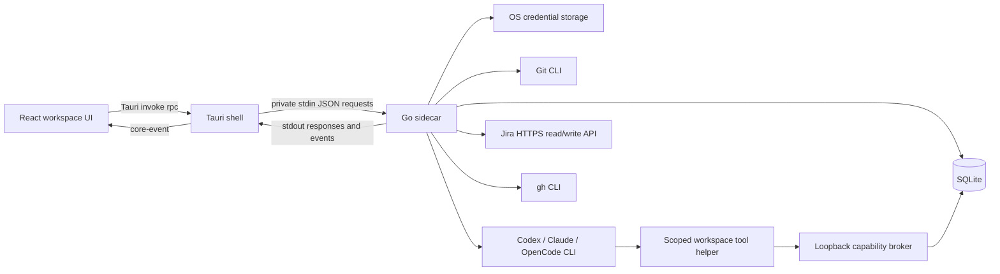

# CommitDeck architecture

## Runtime and trust boundaries

Desktop application RPC uses private pipes. Tool-enabled agent turns use an additional ephemeral loopback broker with a per-turn capability, separate from desktop RPC. The optional OpenCode adapter owns a separate password-protected loopback server for its supported provider transport. Rust creates a sidecar with piped stdin/stdout, correlates request IDs, and emits normalized backend events to the webview. The frontend invokes named backend operations; integrated terminal input deliberately grants the developer ordinary shell access. Native capabilities permit only folder selection and opening links; process/filesystem operations are Go methods.

The browser development bridge in `scripts/dev-core.ts` launches the same sidecar and provides same-origin RPC plus server-sent events through Vite. It validates Host/Origin and JSON content type and has a request-size limit. It is disabled in desktop and test modes. There is no production browser server.

## Workspace model

`internal/workspace` defines the local `Workspace`: a stable random ID, optional external key, title/status, repository/worktree/branch, tracker ID, independent local development lifecycle, archive flag, and timestamps. The random ID is the relational key; a Jira issue key is not the database identity. Multiple workspaces may represent the same ticket and get different worktree directories.

Notes and TODOs belong to exactly one workspace. The initial note is created atomically with the workspace. TODO order is replaced transactionally: the request must contain every task exactly once and every ID must belong to that workspace. Workspaces can be archived without destroying their context. Deletion requires confirmation and cascades local records while retaining Git/provider files.

The React `useDeck` hook caches details by workspace ID. Switching tickets uses the cache immediately and refreshes from local SQLite. Notes live in a separate keyed draft store so unmounting a tab cannot drop pending writes. Its debounce is per workspace, saves are serialized, and a newer draft cannot be overwritten by a slower earlier write. Local draft backups survive a failed write or webview restart. Compare-and-swap note writes prevent a stale user autosave or agent append/replacement from overwriting another edit. Clean editors accept newer server notes; conflicting dirty drafts are preserved with their original base version and a visible merge-review action. Unknown-base legacy backups are never replayed over saved notes automatically. UI layout stores selected workspace, per-workspace tab/session/diff selection, pane sizes, notes mode, and context-pane visibility, Dashboard/workspace view, and Dashboard section collapse choices. The app launches into Dashboard with the last workspace still available. Prompt drafts are keyed by session in webview storage.

## Backend modules

| Module                                     | Responsibility                                                                                       |
| ------------------------------------------ | ---------------------------------------------------------------------------------------------------- |
| `cmd/commitdeck`                           | Stdio request loop, request limits/timeouts, signals, orderly shutdown                               |
| `internal/app`                             | Domain-level use cases and IPC routing; lifecycle exclusion for workspace/worktree mutations         |
| `internal/database`                        | Embedded migrations, SQLite repositories, cache and event persistence, exclusive data-directory lock |
| `internal/workspace`                       | Workspace/note/TODO models and attention calculation                                                 |
| `internal/git`                             | Argument-based Git commands, path validation, worktrees, status and diff parsing                     |
| `internal/agents`                          | Session lifecycle, live process ownership, concurrent streams, cancellation                          |
| `internal/agents/protocol`                 | Provider-independent session/event types and runtime interface                                       |
| `internal/agents/{codex,claude,opencode}`  | CLI invocation and provider wire-event normalization                                                 |
| `internal/issuetracker` / `internal/jira`  | Generic issue model/interface and Jira Cloud implementation                                          |
| `internal/pullrequest` / `internal/github` | Generic PR/review/check models/interface and gh implementation                                       |
| `internal/secrets`                         | Native credential-store interface and implementation                                                 |
| `internal/config`                          | OS data path and default worktree root                                                               |

Additional modules:

| Module                 | Responsibility                                                                                     |
| ---------------------- | -------------------------------------------------------------------------------------------------- |
| `internal/dashboard`   | Bulk local summaries, deterministic priority, sorting, grouping, searchable context                |
| `internal/permissions` | Conservative command classification, exact scoped rules, live response callbacks, expiry           |
| `internal/context`     | Selected local/cached sources, deterministic purpose-aware Markdown, budgets, redaction, snapshots |
| `internal/activity`    | Meaningful events, transition deduplication, notification/read state                               |
| `internal/redact`      | Secret-pattern and credential-URL redaction; sensitive-path exclusions                             |
| `internal/identity`    | Shared random identifiers and UTC timestamps without domain dependency cycles                      |

Frontend features are grouped by workspace, dashboard, context, permissions, activity, agents, tasks, notes, Git, Jira, and GitHub. Shared UI primitives, Markdown, resize controls, typed IPC, and hooks live outside feature panels. Command-palette commands are a data registry of IDs, labels, groups, and callbacks.

## Agent abstraction

`protocol.Runtime` supplies provider identity, availability, explicit CLI command construction, and wire-event normalization. `agents.AgentProvider` describes the domain lifecycle implemented by the manager: start/resume/send/cancel. This separates provider protocol details from shared persistence and process ownership.

Creating a session persists metadata and the exact previewed context snapshot without starting a model request. Sending its first prompt starts a provider process in the worktree and prepends the stored snapshot. Context hashes are checked against a fresh build before creation/refresh; a changed source requires another preview. Resumed native sessions receive only the user prompt unless a new snapshot was explicitly queued. A session without native history gets its stored context again. Legacy sessions without a snapshot receive no hidden new context.

`protocol.InteractiveRuntime` creates a conversation state machine: initial frames, normalized events, native IDs, subsequent wire writes, permission requests, reply functions, input-sent markers, terminal status, and optional response acknowledgements. Provider wire models remain inside adapters. Each session allows one active turn; separate sessions run concurrently.

- **Codex:** private stdio app-server, initialize → start/resume thread → turn, read-only sandbox and untrusted approvals. Handles command, file, and extra-access requests. Extra grants are turn-scoped and explicitly described; unknown server requests are refused.
- **Claude:** streaming JSON control initialization and `can_use_tool` responses in default permission mode. Native session resume is retained. Interactive questions/unknown controls require the terminal UI.
- **OpenCode:** a bridge mode of the bundled Go executable starts an owned v1-compatible `serve` process on loopback with per-process Basic authentication. Uses async prompts, SSE, and permission reply endpoints. Decisions are persisted as approved only after successful HTTP acknowledgement. Redirects are refused and HTTP startup/header/request times bounded.

Supported UI events remain `text`, `status`, `command`, `tool`, `file_changed`, `diff`, `permission_request`, `error`, and `complete`. Unknown events are ignored/refused rather than displayed as raw JSON. Completed text/tool output is rendered; token deltas are not yet rendered live. User prompts and normalized agent output remain in local session history.

Normalized event text, commands, file paths, diffs, tool names, and errors pass through secret-pattern redaction before streaming and before insertion into SQLite. Database insertion enforces this even for callers outside the agent manager. Redaction is best effort for recognized patterns; this does not scrub historical rows or guarantee detection of arbitrary secrets. Provider permission replies keep their original runtime inputs.

Prompt editing and ticket switching retain the full draft in memory. Webview recovery copies pass through the same backend redactor before local storage; unavailable sanitization pauses backup rather than writing raw input. Older drafts are sanitized when the Agent pane opens and the backend is available. Restored copies may therefore contain redaction markers; actual sending still uses the current in-memory prompt the user reviewed.

New timestamps use fixed nanosecond precision and an atomic monotonic sequence, including on Windows clocks with coarse resolution. TODO/notes updates advance beyond the persisted revision so clock rollback or restart cannot reuse that optimistic-concurrency token. These remain RFC 3339 timestamps; existing values require no migration.

## Permission workflow

A normalized request records workspace/session/provider/category, title/description, command/path/cwd, risk, channel availability, and pending/resolved state. Live reply callbacks stay in memory; SQLite does not store a resumable channel. Requests are displayed in Agent, Overview, the global queue, and Dashboard/sidebar attention. Individual decisions reach the owned process, then update persistence and activity. Provider I/O occurs outside the queue mutex; independent requests and server acknowledgements keep flowing.

Scopes are once, session, and workspace. Once creates no rule. Session rules are removed on restart; workspace rules survive. Matching is exact executable + complete argv + cwd + workspace (+ session when applicable), despite the reserved `ArgPrefix` field name. There are no substring/glob grants. Only a narrow set of plain test/check commands can be remembered; execution/config overrides, shell expressions, unsupported wrappers, Git, file writes/deletes, network, and unknown actions remain individual. Codex launchers `/bin/sh`, `/bin/bash`, and `/bin/zsh` with `-c`/`-lc` are eligible only when their one script argument parses as a single plain test command; the entire launcher argv is remembered, with no normalization to a broader inner-command rule. Canonical provider-reported cwd must lie inside the workspace worktree. Missing tool cwd is explicitly marked unverified, uses the session start directory only for display, and prevents remembered rules (currently Claude and OpenCode). Redacted secret-bearing commands cannot be remembered. Tests still execute repository code, so remembered tests imply trust in that repository.

All pending requests expire on process exit, cancellation, or application restart. No stale PID or callback is reused. A failed provider response expires the request instead of showing success. Native provider policies may approve/deny operations before they are reported: this is request mediation, not an independent execution sandbox. Unsupported provider control capabilities are reported and never simulated as approved.

## Workspace context engine

`BuildWorkspaceContext` assembles normalized workspace metadata, cached issue/acceptance/comments, Markdown notes, unfinished/completed TODOs, local Git status/recent commits, cached PR description/checks/unresolved feedback, and concise session metadata. It performs no Jira/GitHub fetch and never reads credentials/environment values or source-file contents. Git failure produces a warning and other sources remain available.

Defaults are 12,000 characters, all six optional sources, with backend normalization to 1,200–64,000 characters. A simple deterministic purpose order prioritizes issue/acceptance and remaining work; review promotes unresolved feedback/Git, testing promotes acceptance/tasks/Git, investigation promotes ticket/notes. Reserved space protects unfinished tasks, acceptance criteria, and unresolved feedback from huge descriptions. Truncated sections are visibly marked and incomplete review feedback adds a warning. Token count is a byte-length heuristic, not a tokenizer guarantee.

Git supplies branch/dirty state, at most 40 nonsensitive changed paths, a change-count and tracked diff-stat summary, and five recent commit subjects. `.env`, private-key and known credential paths are excluded; no full diffs are dumped. Redaction removes known token/password/private-key patterns and URL credentials/query secrets from all rendered context. This is best effort, not guaranteed detection of arbitrary secrets. Only the budgeted/redacted Markdown and metadata cross the context API; raw gathered source objects are discarded.

`agent_session_context` stores full redacted Markdown plus SHA-256, source IDs/options, character count, generated timestamp and sent timestamp. The hash excludes generation time and is stable for identical content. Preview/start bind to that hash; snapshot content rather than live mutable sources is injected. Refresh explicitly queues a new snapshot without altering native resume semantics. Previous sessions contribute only title/provider/purpose/status, never whole conversations.

## Dashboard, activity, notifications

Dashboard reads workspaces, sessions and aggregate joins in a fixed number of local queries. It performs no per-row remote calls. Backend computes priority, grouping, task counts, permission counts, PR state, searchable notes/branch/key/title/PR, and last activity. Shared frontend attention badges are used in Sidebar, Dashboard, header and Overview. Filter/collapse/keyboard operations work locally.

Meaningful events (session lifecycle, tool file changes, permission lifecycle, task changes, PR/CI/review transitions, refresh) enter `workspace_events`. Streamed tokens do not. A transactional `workspace_signals` comparison records actual transitions and prevents repeated polling from generating duplicate notifications. Unique dedupe keys suppress duplicate individual activity. Re-entry into a state after a different state is a new event. The notification center reads important transitions and persists read state separately from activity.

## Event flow

1. Frontend invokes a named backend method through Tauri.
2. Rust writes `{id, method, params}` to the sidecar.
3. Go dispatches bounded concurrent requests and returns `{id, result}` or `{id, error}`.
4. Agent stdout/stderr readers normalize supported activity, persist it, and emit `{event: {type: "agent_event", event: ...}}`.
5. Rust forwards events with `core-event`. React merges live activity with persisted replay by event ID.
6. Session, permission, and activity changes emit `sessions_changed`, `permissions_changed`, or `activity`; the frontend coalesces refreshes before loading local summaries, pending requests, and notifications.

Integration polling runs independently with two jobs at most, a 60-second interval for the selected visible workspace and 180 seconds for background tickets. The scheduler pauses while hidden, records failed attempts to avoid retry storms, and supports explicit interval-bypassing refresh. Local summaries refresh every 15 seconds while visible as a fallback to streamed events. Git status refreshes while its panel is open. Each subsystem retains its own loading/error state; local notes/tasks do not await integration calls. A failed Jira/PR refresh leaves the previous successful cache and timestamp intact.

## Issue tracker abstraction

`issuetracker.IssueTracker.GetIssue` returns a normalized `Issue` with author names, comments, labels, links, status/priority, description, acceptance criteria, URL, and update time. Jira-specific ADF and REST structures remain inside `internal/jira`. The Cloud adapter uses HTTPS Basic authentication with account email and an API token obtained from the native secret store. Redirects are not followed, preventing credential forwarding to another destination. Comments are paginated; HTTP bodies and request times are bounded.

Import reads the issue, creates a local workspace/main note, and caches the normalized issue. Failed imports remove the just-created local record. Refresh replaces the cache only after a successful fetch. It does not overwrite locally edited workspace notes or TODOs. Future trackers can implement the interface without adding Jira fields to the frontend.

## Pull request provider abstraction

`pullrequest.PullRequestService` exposes branch lookup, checks, and reviews using normalized domain types. `github.CLI` parses a github.com origin remote and runs `gh pr list` with explicit repository and branch flags. The response includes normalized PR metadata, latest effective approvals/change requests, reviewers, reviews, and check status. A separate paginated gh API read counts inline review comments; GraphQL review threads add unresolved feedback. Extremely long threads include an explicit incomplete-cache warning. Credentials remain under gh's control.

Branch lookup includes open, closed, and merged PRs so merge completion remains visible and drives local lifecycle. A lookup with no matching PR caches `null`; a failed lookup preserves the cache. Check conclusions are normalized to success/failure/pending. GitHub Enterprise and alternative remotes remain extension points.

## Attention priority

Attention is derived from local session metadata and cached PR data:

1. `AGENT_WAITING`
2. `CHANGES_REQUESTED`
3. `CI_FAILED`
4. `MERGE_CONFLICT`
5. `BLOCKED`
6. `AGENT_RUNNING`
7. `CODING`
8. `READY_TO_MERGE`
9. `WAITING_FOR_REVIEW`
10. `NO_PR`
11. `IDLE`

Ready requires an open nondraft mergeable PR, approved review state, and all reported checks successful. Zero checks alone does not grant approval. Attention reflects the last successful remote sync, whose timestamp is visible in integration panels. The app never merges automatically.

## SQLite and secrets

Embedded numbered SQL files are applied transactionally and tracked by `schema_migrations`. Migration 002 adds `permission_requests`, `permission_rules`, `agent_session_context`, `workspace_events`, and `workspace_signals` and normalizes legacy session statuses without deleting data. Original tables: `workspaces`, `notes`, `todos`, `agent_sessions`, `agent_events`, `settings`, `jira_cache`, and `pull_request_cache`. Foreign keys are enabled, child tables cascade on workspace/session deletion, and workspace/order/session indexes support local reads. WAL and a busy timeout protect short writes. A single connection serializes database access; external I/O occurs outside database transactions.

An OS file lock prevents a second backend from opening the same data directory and misclassifying the first instance's active sessions. Lock ownership is released by the OS on crash. The app directory is created with private permissions and the database with mode 0600 on Unix. SQLite stores no Jira token. `secrets.Native` uses the OS credential store, with no plaintext fallback. Jira account/email/base URL are nonsecret settings. gh/provider authentication stays external.

## Git and filesystem safety

Paths are canonicalized and repositories validated before attachment. Branch names are generated from sanitized ticket/title text and checked with Git. Worktree folders include a workspace-ID suffix. Existing registered worktrees are detected; existing branches are reused only if not checked out elsewhere. Existing filesystem directories are not overwritten.

Removal requires explicit confirmation, rejects the primary repository, validates worktree registration, refuses active agents and running terminals, and checks for dirty/untracked/ignored files. `git worktree remove` runs without force. Branches are never deleted. Local Git never resets, cleans, commits, pushes, deletes branches, or evaluates concatenated shell strings. Confirmed GitHub squash merge is a separate remote action with head-SHA and readiness guards. Staged and unstaged diffs disable external diff/textconv tools. Untracked previews reject escaping symlinks, nonregular files, binary content, and files larger than 2 MB.

## Process management and shutdown

The Go manager maps session IDs to only the `exec.Cmd` instances it created. SQLite tracks workspace/provider/session/status/PID metadata. A lifecycle mutex prevents starting an agent while the same application removes or reattaches its worktree. Archiving/deleting a workspace or removing its worktree is refused while an agent or terminal is active.

On Unix, each turn gets its own process group. Cancellation kills that owned group; Windows uses `taskkill /PID <owned-pid> /T /F`. There is no name-based process killing. Stream reader errors, command failures, cancellation, completion, and external session IDs are persisted. A crash in one agent does not stop others.

Tauri closes sidecar stdin on exit. Go cancels outstanding requests, stops its agent processes, waits for readers, and closes SQLite. Rust has a bounded shutdown wait and a final sidecar-only kill fallback. An unexpected restart marks active/waiting session metadata `idle`, clears stale PIDs, expires pending permissions, removes session rules, and offers native-session continuation on the next prompt. Workspace rules remain. It never sends signals based on persisted stale PIDs. Agents do not survive an orderly app shutdown.

## Verification and extension points

Tests cover local workflows and real Git worktrees, SQLite restart/cascades/order, integration normalization, attention, safe paths, concurrent/cancelled/crashed agents, note write races and recovery, and keyboard tasks. `scripts/smoke.mjs` drives real stdio IPC with a disposable repository and data directory. External account authentication is a separate manual setup step; fixtures are never represented as live service verification.

Add migrations for schema changes, implement a new `Runtime` for agents, replace the issue-tracker factory for other trackers, or implement `PullRequestService` for another forge. New interactive providers implement conversation state machines without changing the domain renderer. Additional context sources, permission categories, or transition types can extend their respective packages. Future improvements include capability/version negotiation, interactive questions, virtualized history, signed releases, automatic updates, and local Git stage/commit/push flows.

## Phase 3 services and migration

Migration `003_daily_workspace.sql` adds `terminals`, `agent_imports`, `agent_workflows`, `agent_workflow_steps`, and `workspace_tool_events`. It extends existing workspace rows with `lifecycle`, notes/TODOs with `updated_by` and `session_id`, and agent sessions with import/resume/source-CWD metadata. Existing context, caches, permissions, notes, tasks, and transcripts remain. Lifecycle initializes to Backlog, Coding for existing worktrees, or Archived. Attribution defaults to the user.

`internal/terminal` owns real Unix PTYs / Windows ConPTY, validates current worktree CWD, streams sequenced base64 events, and keeps 256 KiB memory buffers. Persisted tabs become stopped on restart. xterm.js is loaded when needed and retains view state across workspace/tab navigation. Terminal selections enter an explicit editable agent prompt. Dock size, split state, terminal selection, Git-list width, and per-workspace tabs use the existing layout store. See [terminal.md](terminal.md).

`internal/agents/discovery` independently queries provider metadata and returns normalized discovered sessions and warnings. It isolates Claude JSONL parsing, validates IDs, redacts known secret patterns, scores path/branch/key matches, and records explicit imports with transactional duplicate prevention. Imported IDs reuse existing adapters; readonly metadata cannot be sent prompts. No provider transcripts or credentials are copied. See [session-import.md](session-import.md).

`internal/workspacetools` supplies a session-scoped helper protocol. An active, tool-enabled context snapshot allows the manager to bind a random capability for that turn and pass connection details only through its process environment. `commitdeck-core --workspace-tool` acts as the client and never opens SQLite. The broker accepts only narrow knowledge operations against the bound workspace; destructive edits enter the existing permission queue, never reusable rules. Known secret patterns are redacted; note updates have optimistic concurrency checks. Provider skill files contain no capabilities and require confirmed creation with no overwrite or filesystem-root escape. See [agent-skill.md](agent-skill.md).

`issuetracker.WritableIssueTracker` adds available transitions, comments, and summary updates. `pullrequest.WritableService` adds normalized actions executed by the isolated gh adapter. Frontend dialogs require confirmation; backend use cases check confirmation, scope to the workspace repository/issue, re-read the PR, and enforce merge-head/readiness guards. API bodies use JSON/stdin or explicit process arguments. Jira transitions are revalidated, and review replies map to their root comment. Remote success followed by cache-refresh failure is reported as success with a refresh warning so users do not accidentally post again. See [workflows.md](workflows.md).

`workspace.DevelopmentState` owns the deterministic local lifecycle derived from existing worktree and normalized PR state, with explicit Done/Blocked/Archived states. Attention remains separately prioritized for dashboard decisions. Start Work previews branch/base/fetch/worktree operations; archive preserves all relational context and cleanup stays opt-in and guarded.

`internal/workflows` persists ordered steps and session links, starts only one explicitly approved step at a time, and receives completion callbacks from the existing agent manager. It builds fresh selected context and a bounded/redacted last-assistant handoff, never a full prior conversation. In-flight steps become failed after restart; failures require retry/skip/stop, and stopped workflows cannot reactivate from late process callbacks. Step completion/failure feeds deduplicated activity notifications. Manual sessions remain independent.

New frontend feature modules cover terminal, workflow, import, skill, and remote action flows. Overview composes their summaries and launch actions. Activity is a first-class tab. Fuzzy palette commands and shortcuts share the same actions; app shortcuts yield to terminal input. Errors/loading state stay scoped to each panel.

`npm run test:phase3` drives a real sidecar, PTY, helper capability, permission denial, attributed knowledge changes, explicit workflow handoff, and stopped terminal recovery using a disposable database and fake provider CLI. Backend tests cover scoped/expired capabilities, write payloads/guards, migration preservation, PTYs, matching/import duplication, lifecycle, note races, and workflow failure/retry. Native Windows ConPTY and live authenticated provider/Jira/GitHub writes remain manual verification items; fixtures are not production claims.
